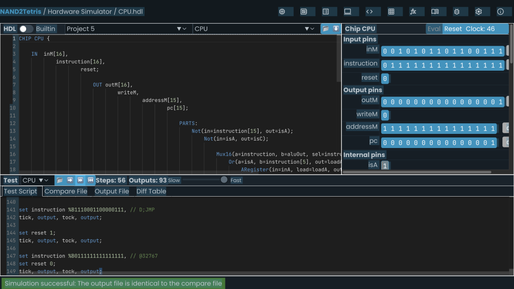
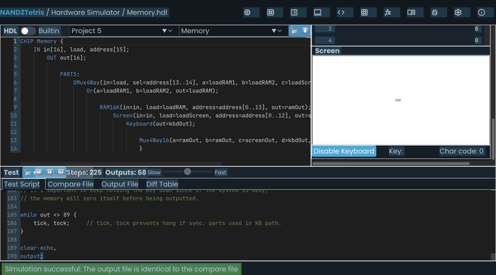
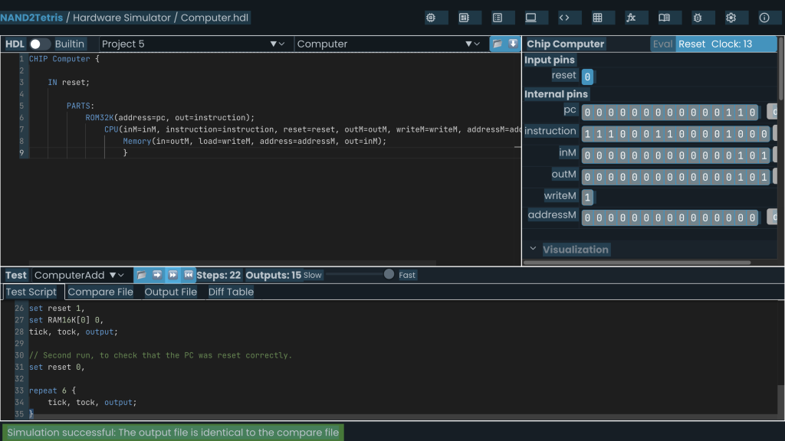
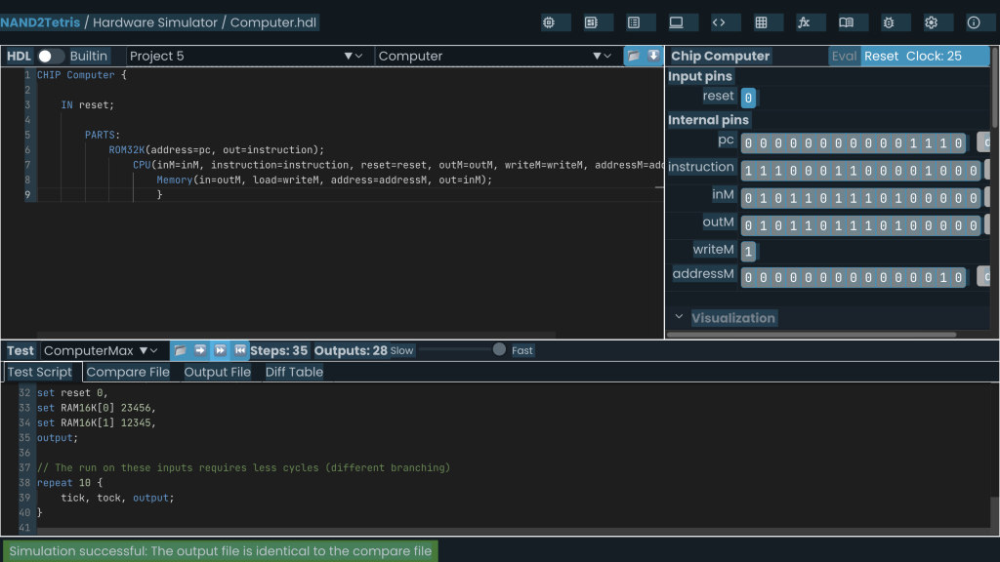
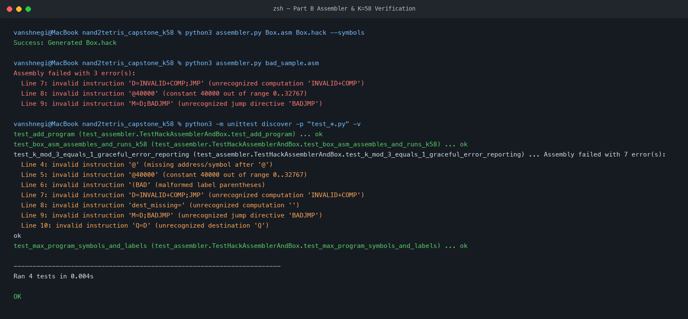
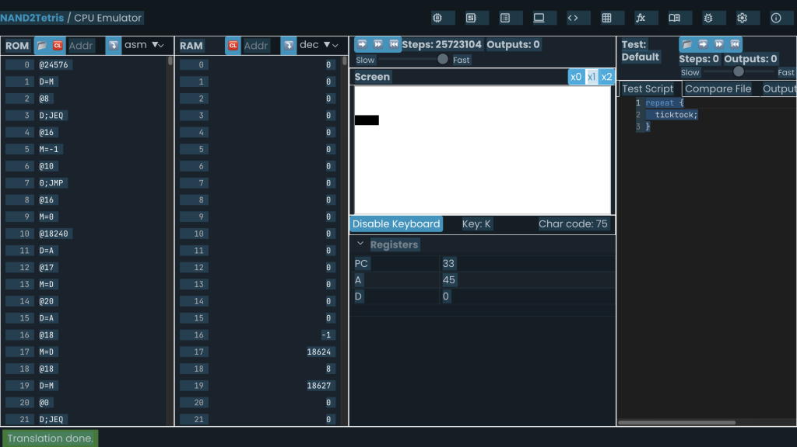

# Nand2Tetris Capstone Project

**Name:** Vansh Negi  
**Roll No:** 2501730158  
**K:** 58  

---

## Part A: Build the Computer (`CPU.hdl`, `Memory.hdl`, `Computer.hdl`)

### 1. CPU (`CPU.tst`)
Built `CPU.hdl` with A/D registers, ALU, and PC jump logic. Passed `CPU.tst` in the Hardware Simulator.



### 2. Memory (`Memory.tst`)
Built `Memory.hdl` mapping RAM16K (`0..16383`), Screen (`16384..24575`), and Keyboard (`24576`). Passed `Memory.tst`.



### 3. Computer (`ComputerAdd.tst`, `ComputerMax.tst`, `ComputerRect.tst`)
Connected `ROM32K`, `CPU`, and `Memory` in `Computer.hdl`. All three Computer tests passed.






---

## Part B: Hack Assembler (`assembler.py`)

**Question ($K \bmod 3 = 58 \bmod 3 = 1$):** Print a clear error message with the line number for any invalid line instead of crashing.

Commands run:
```zsh
python3 assembler.py Box.asm Box.hack --symbols
python3 assembler.py bad_sample.asm
python3 -m unittest discover -p "test_*.py" -v
```



---

## Part C: Draw a Box (`Box.asm` / `Box.hack`)

**Question ($K = 58$):** Draw a black box on the left edge when any key is pressed and clear it when released.
- **Starting row:** Row `58` (`16384 + 32 * 58 = 18240`)
- **Width:** `16 * ((58 mod 4) + 1) = 48 pixels` (`3` words per row)
- **Height:** `20 rows` (rows `58` to `77`)

Loaded `Box.asm` into the CPU Emulator and pressed key `K` (`Char code: 75`):



---

## One Mistake I Fixed

While testing `CPU.hdl`, A-instructions like `@18240` were causing the PC to jump by mistake because I wired the jump signals directly to `PC(load=...)` without checking if the instruction was a C-instruction. Adding `And(a=isC, b=jumpCond, out=loadPC)` fixed it so only C-instructions (`instruction[15] = 1`) can jump.
